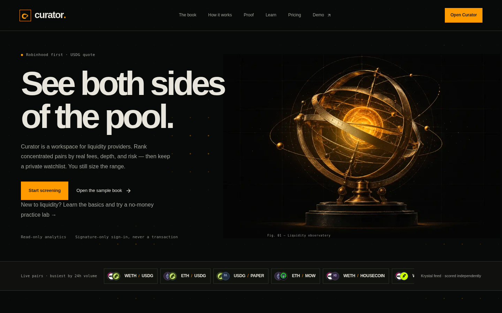
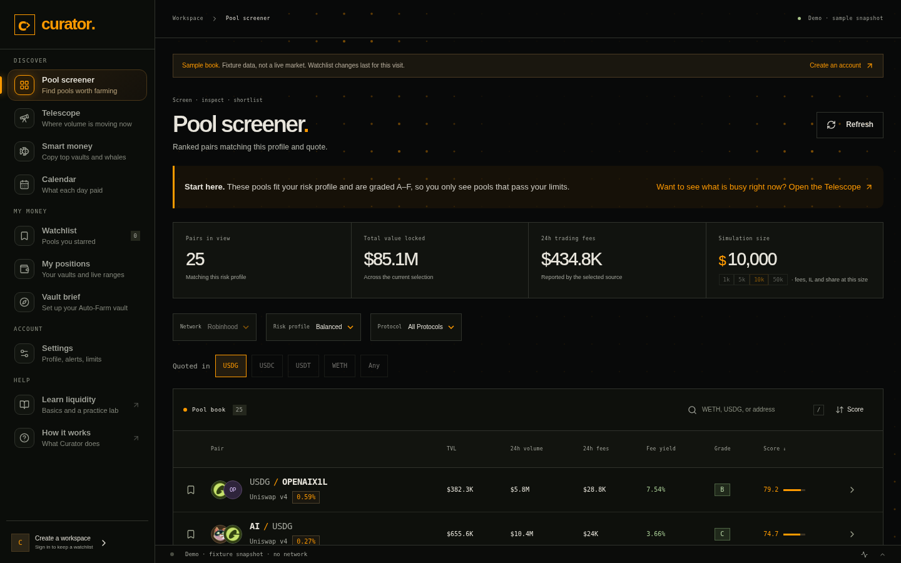
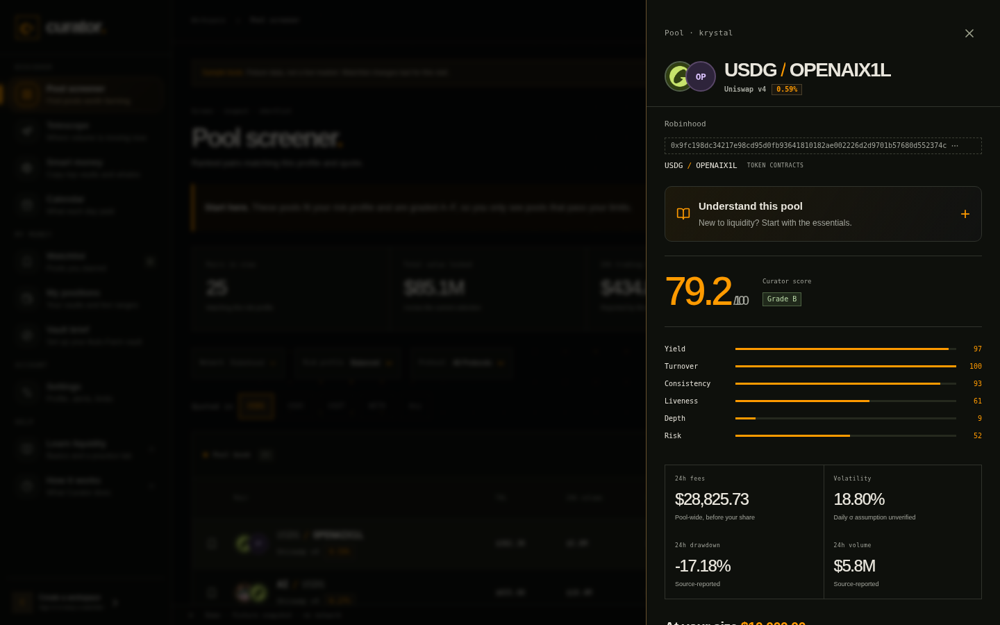
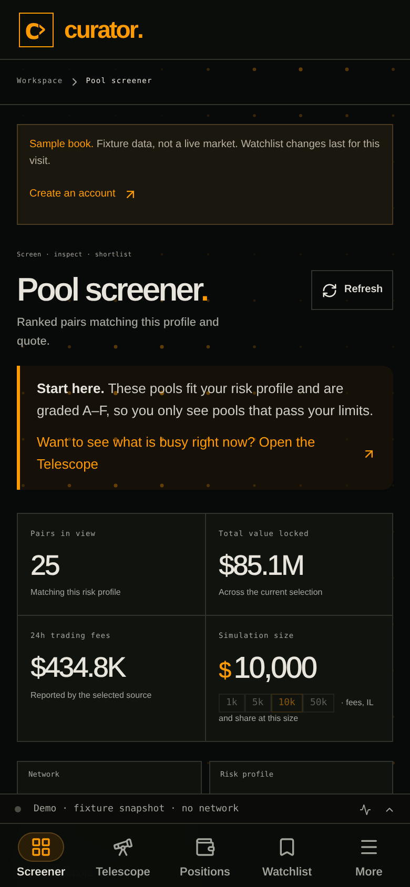
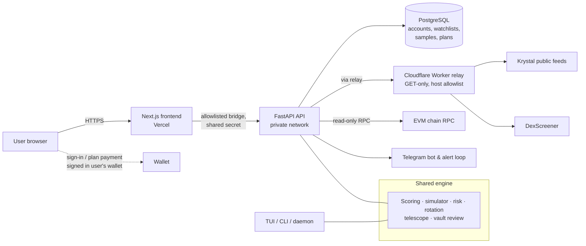

# Curator (kcurator.tech)

**An analytics workspace for Krystal liquidity providers. It ranks concentrated-liquidity pools by real fees, depth and risk, then keeps score of its own calls.**

🔗 **Live:** [kcurator.tech](https://kcurator.tech) · **Try it without an account:** [sample book](https://kcurator.tech/demo) · **Learn LP basics:** [field guide + practice lab](https://kcurator.tech/learn)

> This is a public showcase. The source code is in a private repository. To get a walkthrough or a live demo, contact me (see [Hire me](#hire-me)).

---

## The problem

Liquidity providers on [Krystal](https://defi.krystal.app) can choose from hundreds of concentrated-liquidity pools, but the headline numbers can mislead:

- **APR from one good day.** A single day with a fee spike can make a pool look great even when it usually earns little.
- **Pool totals instead of your share.** Fee totals tell you what the whole pool earned. They don't tell you what *your* position would earn after it dilutes the pool, or after impermanent loss.
- **No signal for when to move.** It is hard to tell whether a position has decayed and should rotate to another pool, or whether to stay put.
- **No accountability.** Most dashboards never check their past recommendations against what the pool actually paid.

Curator is a **read-only** answer to this. It never signs or sends a transaction: you sign in with your wallet or an email, and you stay in control of every move.

## Key features

| Area | What it does |
|---|---|
| **Pool screener** | Ranks pools with a 0–100 score built from yield, turnover, consistency, liveness, depth and risk, plus an A–E risk grade. Yield uses the *lower* of today and the 7-day average, so one spike day can't carry a pool. Includes selectable risk profiles (conservative → degen) and network, protocol and quote filters. |
| **Position simulator** | Choose a position size and see *your* fees per day after dilution, an impermanent-loss estimate, net per day, your share of the pool, and a suggested ±range based on the pool's volatility. |
| **Rotation verdicts** | Simulates the same dollars in the top pools and returns ROTATE / CONSIDER / STAY, with the number of days it takes to earn back the switching cost. |
| **Telescope** | Shows where trading volume is accelerating right now (pace, day vs week, z-score, heat) and groups pools by market, with flags such as SURGE, BREAKOUT and THIN. |
| **Smart money / whales** | Tracks public Krystal Auto-Farm vaults that pass an age, TVL and ROI bar: which pools they are entering and leaving, joined with volume data. |
| **Vault review & leaderboard** | A rule-based review of any public Auto-Farm vault: observed performance, fit against your risk limits, and how strong the evidence is. Verdicts are `avoid` / `watch` / `worth_testing` / `insufficient_data`. |
| **Snipe plans** | Turns a reading into a written plan: why now, entry size and range, exit rules, risks, and a DexScreener-based rug check that blocks plans when a check fails. |
| **Public track record** | [/proof](https://kcurator.tech/proof) logs every plan's prediction and judges it against what the pool actually paid. Nothing is filtered out. |
| **Alerts** | Telegram alerts for out-of-range positions, range edges coming close, pools dropping a grade, PnL drops and rotation changes. Includes a Telegram bot with a menu-driven flow for phones. |
| **Learn** | A beginner field guide and a no-money concentrated-liquidity practice lab. It needs no wallet or account. |
| **Power-user terminal** | A Bloomberg-style terminal UI, a CLI and a headless monitor daemon that share the same scoring engine. |

## Screenshots

| Pool screener (sample data) | Pool detail & score breakdown |
|---|---|
|  |  |

| Learn: field guide & practice lab | Mobile |
|---|---|
|  |   |

*The screener screenshots come from the public `/demo` sample book, which uses fixture data labelled as non-live. No personal wallet data is shown.*

## Tech stack

- **Frontend:** Next.js 16, React 19, TypeScript, viem (wallet sign-in), deployed on Vercel
- **Backend:** Python 3.13, FastAPI + Uvicorn, PostgreSQL via Tortoise ORM + asyncpg, Aerich migrations
- **Auth:** Sign-In with Ethereum (EIP-4361, wallet discovery via EIP-6963) or email and password (Argon2), with hashed, expiring sessions in HttpOnly cookies
- **On-chain:** a small Solidity payment-receipt contract (Foundry, with tests) for stablecoin plan payments, and read-only EVM RPC checks pinned to a single block hash
- **Infra:** Docker Compose, nginx, a Cloudflare Worker relay, and systemd/launchd units for the daemon
- **Terminal:** Textual (TUI), httpx
- **Optional AI add-on:** a local small LLM run through llama.cpp with grammar-constrained tool calls
- **Quality:** pytest (Python suite), Playwright browser tests at 1440 / 768 / 390 px, ruff, TypeScript type checks

## Architecture

One Python scoring engine runs everything: the web API, the terminal UI and the headless monitor. That way a pool scores the same on every surface.

## Engineering challenges and how they were solved

- **Datacenter IPs get challenged by the upstream feeds.** Krystal's public feeds challenge server traffic. By default the browser fetches the raw data from a "recipe" the API sends, then posts it back, and each user's cache is kept separate so no one can poison another user's screener. For server-side fetching there's a small GET-only Cloudflare Worker relay with a host allowlist and a shared key.
- **Being honest about unknown data.** When a feed doesn't provide a time window, the value is marked *unknown* instead of zero-filled. In that case yield takes a haircut and spike or fading flags are not claimed. Volatility assumptions are labelled "unverified" until a built-in backtest (`--sigma`) checks them against realised price history.
- **Reliable alerts with no duplicates.** All outbound calls go through one helper that retries with exponential backoff and jitter and honours `Retry-After`. A POST is retried only when it provably never reached the server, so an alert is never sent twice. Tokens are removed from error text, and the alert loop takes a lease in the database so several workers can't double-send.
- **Making a 2B local model useful.** llama.cpp grammars force every agent step into valid JSON. The loop caps tool calls, removes duplicate calls, and forces a final answer when the budget runs out. Any number the model gives that never appeared in a tool result is flagged as **unverified**.
- **Safe-by-design web app.** There is no trade signing, ownership comes from the session, client-supplied ownership fields are rejected, rate limits use database row locks, mutation origins are checked and JSON body sizes are capped.
- **On-chain evidence without false confidence.** Contract checks read bytecode at one pinned block hash and report possible capabilities as observations, *not* as a safety score. Proxies that can't be resolved are reported as unknown.
- **Payments with no custody.** The payment contract holds no funds and knows no prices. It moves an allowed stablecoin straight to a multisig treasury and emits a receipt event, and the API settles the invoice from that event.

## Status & roadmap

- **Live:** the landing page, the demo sample book, Learn, the Proof track record, and the signed-in workspace (screener, watchlist, positions, leaderboard, telescope, smart money, calendar, settings). Robinhood Chain is the first-class network; the site also lists Base, Ethereum, Arbitrum and more.
- **CLI / TUI / daemon:** working, and used alongside the web app.
- **Planned:** deeper fee-evidence and range analytics, plus a first-party chain indexer (design documents are in the private repo).
- **Not yet built:** email verification and password recovery.

## Source code

The source code is **private**. I'm glad to do a screen-share walkthrough of the codebase, architecture or tests for clients or collaborators. Reach me on X or LinkedIn below.

## Hire me

I'm **Dimas Victor**, a full-stack developer who builds data-heavy products and AI automations end to end. Curator shows the kind of work I do:

- **Pool analytics builds for DeFi teams:** LP and vault dashboards, scoring and risk models, alert bots, read-only on-chain checks, and public track-record pages.
- **AI automation builds for small businesses and startups:** agents and workflows that call real tools with guardrails, Telegram/Slack bots, data pipelines and internal dashboards.

📫 [GitHub @dvictor357](https://github.com/dvictor357) · [X @dvictor3579](https://x.com/dvictor3579) · [LinkedIn](https://www.linkedin.com/in/dimasvic/)

---

Curator consumes Krystal and DexScreener data over public HTTP and redistributes none of it. Curator is an analytics tool, not financial advice. © 2026 Dimas Victor.
